<div align="center">

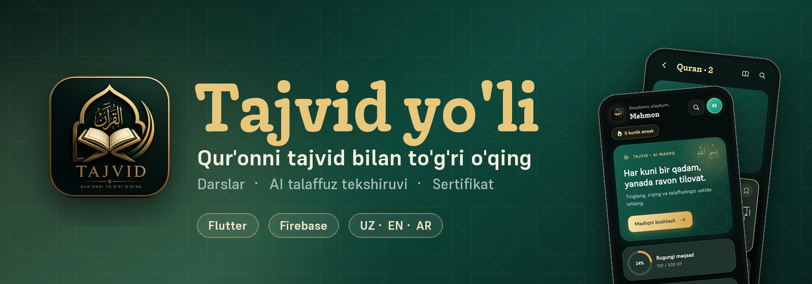

<br>

**Qur'onni tajvid qoidalari bilan o'rganish ilovasi**<br>
Arab alifbosidan tajvid kursigacha bosqichma-bosqich darslar, tilovat audiosi va talaffuzni tekshiruvchi sun'iy intellekt.

<br>


<br>

[Imkoniyatlar](#-imkoniyatlar) · [Ekranlar](#-ekranlar) · [Sayt va admin](#-sayt-va-admin-panel) · [Ishga tushirish](#-ishga-tushirish) · [Firebase](#-firebase) · [Tuzilma](#-tuzilma)

</div>

<br>

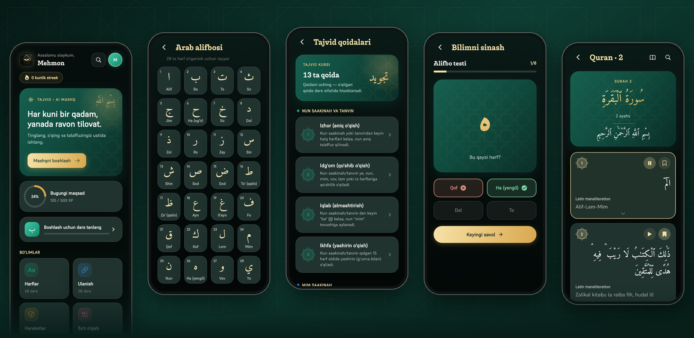

<br>

## ✨ Imkoniyatlar

<table>
<tr>
<td width="50%" valign="top">

### 📚 O'rganish
- Arab **alifbosi**, harakatlar, so'z o'qish va harf ulanishi
- **Tajvid kursi**: 13 qoida, har biri misol va mashq bilan
- Testlar, kunlik reja, **streak** va XP
- Sertifikatlar

</td>
<td width="50%" valign="top">

### 🎙 Tilovat va AI
- **Qur'on o'quvchi** va sura kitobi, offline ishlash
- **AI talaffuz tekshiruvi** (Firebase AI Logic · Gemini)
- Ovoz orqali **sura topish**
- Saqlangan oyatlar va qidiruv

</td>
</tr>
<tr>
<td width="50%" valign="top">

### 🔔 Aqlli eslatmalar
- Kunlik dars eslatmasi (matnlar aylanib turadi)
- Ertalabki tajvid maslahati va **juma** xabari
- **Streak himoyasi** va qaytish xabarlari
- Hammasi qurilmada, internet shart emas

</td>
<td width="50%" valign="top">

### 💎 Premium tajriba
- Zumrad-oltin **shisha (glass)** dizayn, yorug'/qorong'i mavzu
- **3 til**: o'zbek, ingliz, arab (RTL to'liq)
- Silliq tablar va sirpanuvchi pastki panel
- Ilova ichida **fikr bildirish** (yulduz + matn)

</td>
</tr>
</table>

## 📱 Ekranlar

<div align="center">
<table>
<tr>
<td>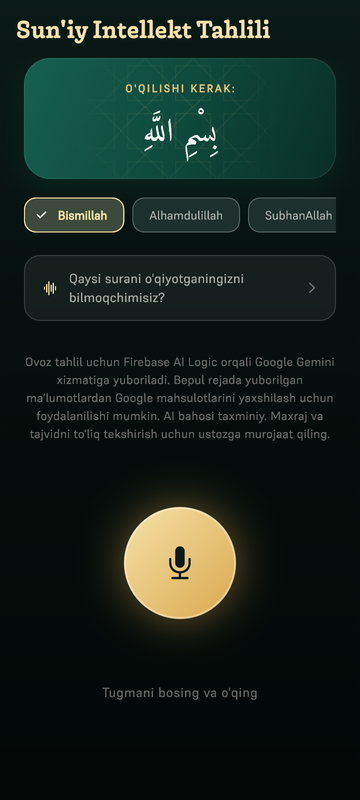</td>
<td>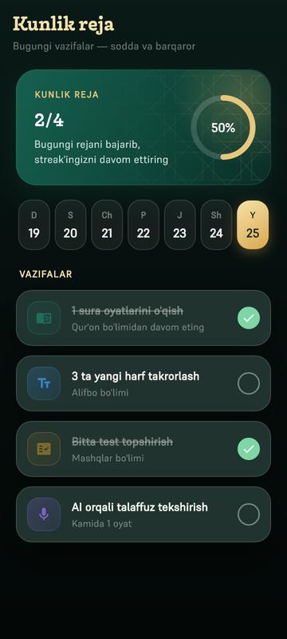</td>
<td>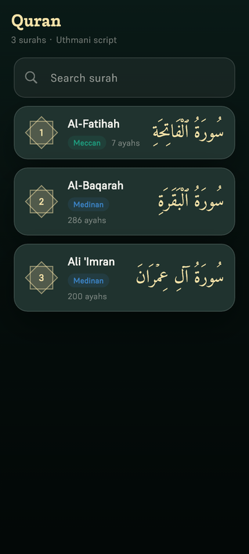</td>
<td>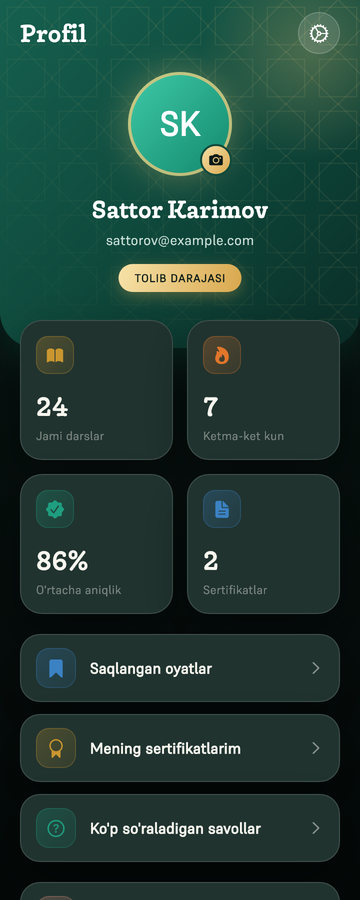</td>
<td>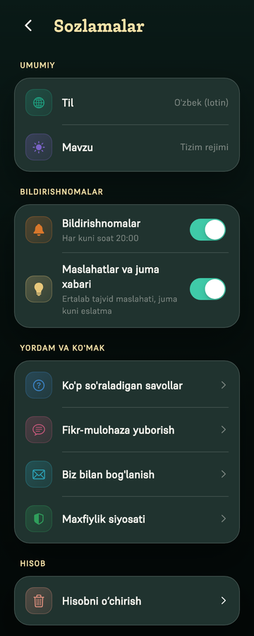</td>
</tr>
<tr align="center">
<td><sub><b>AI tekshiruv</b></sub></td>
<td><sub><b>Kunlik reja</b></sub></td>
<td><sub><b>Suralar</b></sub></td>
<td><sub><b>Profil</b></sub></td>
<td><sub><b>Sozlamalar</b></sub></td>
</tr>
</table>

<details>
<summary><b>☀️ Yorug' mavzu</b></summary>
<br>
<table>
<tr>
<td>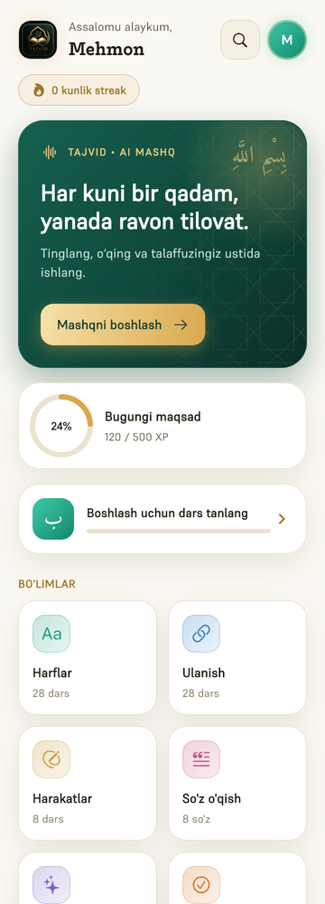</td>
<td>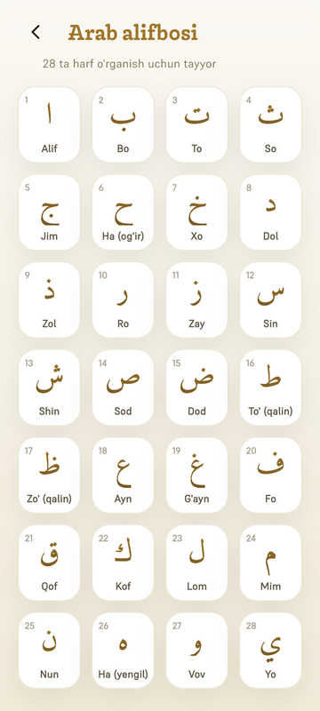</td>
<td>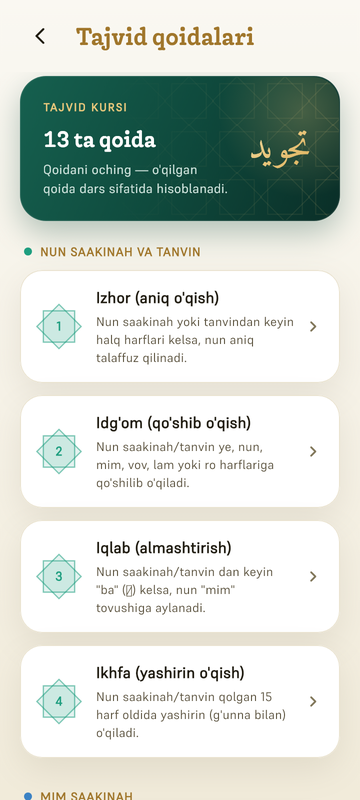</td>
</tr>
</table>
</details>
</div>

## 🌐 Sayt va admin panel

| | |
|---|---|
| 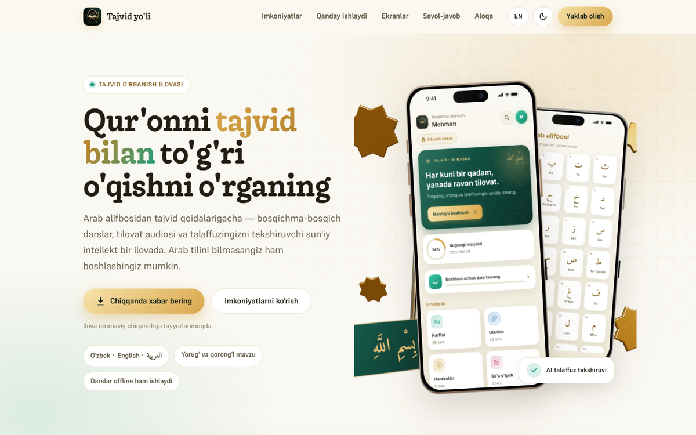 | **Reklama sayti** (`website/`)<br><br>Statik HTML/CSS/JS, build kerak emas. Haqiqiy **3D iPhone 16 Pro Max** (Three.js), ikki tilli (uz/en), toza manzillar (`/privacy/`), yuklab olish tugmasi `downloads/tajvid-yoli.apk` qo'yilganda o'zi paydo bo'ladi. |
| 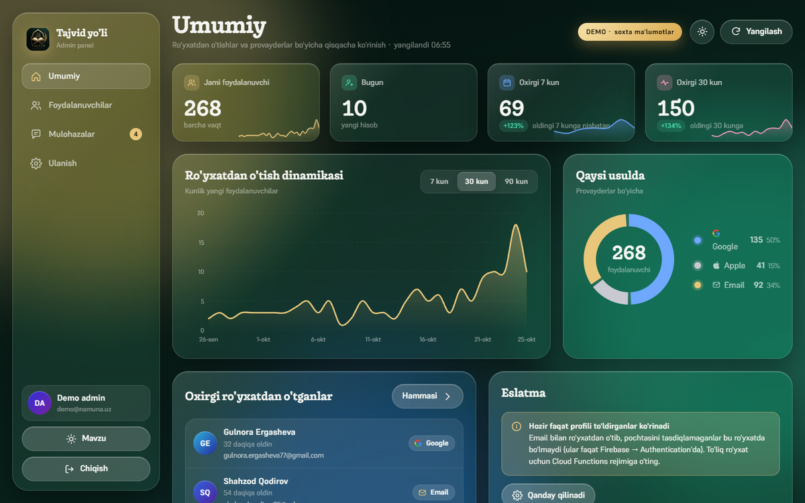 | **Admin panel** (`admin/`)<br><br>iOS uslubidagi shisha interfeys. Email va parol bilan kirish, ro'yxatdan o'tganlar statistikasi (Google · Apple · Email), foydalanuvchilar ro'yxati, CSV eksport. Faqat ruxsat berilgan admin emaili kira oladi. |
| 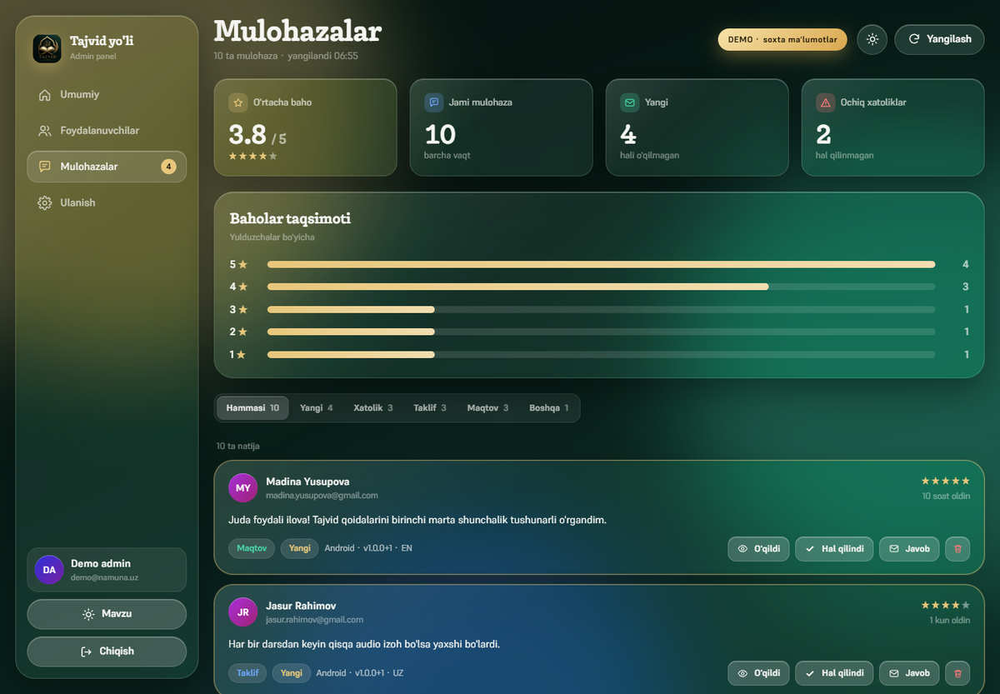 | **Mulohazalar**<br><br>Foydalanuvchilar ilova ichidan yuborgan fikrlar shu yerga tushadi: o'rtacha baho, baholar taqsimoti, tur bo'yicha filtr, «o'qildi / hal qilindi» holatlari va javob berish. |

## 🚀 Ishga tushirish

> Talab: **Flutter 3.44+** (Dart 3.3+), Android Studio yoki Xcode.

```bash
flutter pub get
flutter run --dart-define-from-file=ai_config.json
flutter test
flutter analyze
```

<details>
<summary><b>🔐 Maxfiy sozlamalar (omborda YO'Q)</b></summary>

Quyidagi fayllar `.gitignore` da. Namunalarni nusxalab, o'zingiznikini to'ldiring:

| Fayl | Namuna | Nima uchun |
|---|---|---|
| `ai_config.json` | `ai_config.json.example` | Gemini sozlamalari |
| `app_check_android_config.json` | `*.example` | App Check debug tokeni |
| `app_check_ios_config.json` | `*.example` | App Check debug tokeni |
| `android/key.properties` + `*.jks` | — | Release imzo kaliti |

> ⚠️ **Imzo kalitini (`upload-keystore.jks`) zaxiralang.** Yo'qolsa, Google Play'dagi ilovani yangilab bo'lmaydi.
</details>

<details>
<summary><b>📦 Release yig'ish</b></summary>

```bash
flutter build apk --release --target-platform android-arm64   # ~40 MB, zamonaviy telefonlar
flutter build apk --release --split-per-abi                   # har bir arxitektura alohida
flutter build appbundle --release                             # Google Play uchun
```
</details>

<details>
<summary><b>🖥 Sayt va admin panelni mahalliy ko'rish</b></summary>

```bash
cd website && python -m http.server 8790     # http://127.0.0.1:8790
cd admin   && python -m http.server 8800     # http://127.0.0.1:8800   (demo: ?demo=1)
```
</details>

## 🔥 Firebase

Loyiha: `tajvi-yo-li` · **Authentication** (email, Google, Apple) · **Firestore** · **Storage** · **Crashlytics** · **App Check** · **AI Logic** · **Functions**

```bash
firebase deploy --only firestore:rules     # Firestore qoidalari
firebase deploy --only functions           # Blaze tarifi kerak
```

Adminlar `firestore.rules` dagi `isAdmin()` ro'yxatida **UID** bilan aniqlanadi (email ochiq yozilmaydi). Yangi admin:
Console'da hisob yarating (Authentication → Users → Add user), uning UID sini ro'yxatga qo'shib, qoidalarni qayta deploy qiling.

### Xavfsizlik
Batafsil: [SECURITY.md](SECURITY.md) (himoya qatlamlari, qo'lda qilinadigan sozlamalar, qabul qilingan xavflar)

- Har bir foydalanuvchi faqat **o'z** hujjatini o'qiydi va yozadi, maydonlar qoidalarda qat'iy tekshiriladi
- Mulohazani istalgan tasdiqlangan foydalanuvchi **yozadi**, lekin faqat admin **o'qiydi**
- Admin panel sahifasi ochiq bo'lsa ham, ma'lumotni faqat admin hisobi (UID) ola oladi

## ☁️ Joylash

- **Sayt Vercel'da**: `https://tajvid-yoli.vercel.app` (sozlama: `website/vercel.json`). Yangilash: `cd website && vercel deploy --prod`
- Sayt toza manzillarda ishlaydi, domen **ildizida** joylanishi kerak (`tajvidyoli.uz/`)
- Admin panelni saytdan **alohida** (`boshqaruv.<domen>`) joylang va server darajasida yoping:
  [`deploy/nginx.example.conf`](deploy/nginx.example.conf), [`admin/README.md`](admin/README.md), [`website/README.md`](website/README.md)
- Domen olingach SEO manzillarini almashtiring: `python deploy/set_domain.py https://tajvidyoli.uz` (canonical, og:url, sitemap, robots)
- Google qidiruvi: sayt `sitemap.xml` va `robots.txt` bilan tayyor; Google Search Console'da domenni qo'shib, sitemap'ni yuboring
- Katta `tajvid-yoli.apk` ni omborga emas, GitHub **Releases** ga qo'ying

## 🔄 Yangi versiya chiqarish (Google Play'siz)

Bitta buyruq: testlar → APK yig'ish → saytga joylash → GitHub Release.

```bash
python deploy/release.py 1.0.3 --notes-uz "Yangi dizayn va xatolar tuzatildi"
```

Ilova ochilganda saytdagi `version.json` ni tekshiradi va yangi versiya bo'lsa yuklab olishni taklif qiladi
(`--min-build N` bersangiz, eski versiyalar majburan yangilanadi). Saytdagi yuklab olish tugmasi ham avtomatik yangilanadi.
Imkoniyatlar: `--arm64` (tezroq), `--skip-tests`, `--no-deploy`, `--no-git`, `--dry-run`.

## 🗂 Tuzilma

```text
lib/
  core/        tema, l10n (uz/en/ar), router, servislar (bildirishnoma, AI), vidjetlar
  features/    auth, home, quran, lessons, ai_check, daily_plan, feedback, settings, ...
test/          vidjet va birlik testlari
functions/     Cloud Functions + testlar
website/       reklama sayti (3D)
admin/         admin panel
deploy/        server sozlamalari namunasi
```

## ✅ Sifat nazorati

GitHub Actions ([`ci.yml`](.github/workflows/ci.yml)) har yuborishda ishga tushadi:

| Tekshiruv | Nima |
|---|---|
| **Flutter** | `flutter analyze` va barcha testlar |
| **Functions** | Cloud Functions testlari |
| **Web** | Sayt/admin JavaScript sintaksisi va ichki havolalar |

## 📄 Litsenziya

Barcha huquqlar himoyalangan. Qarang: [LICENSE](LICENSE).

<div align="center">
<br>
<sub>Tajvid yo'li · Qur'onni to'g'ri o'qishga bir qadam 🌙</sub>
</div>
